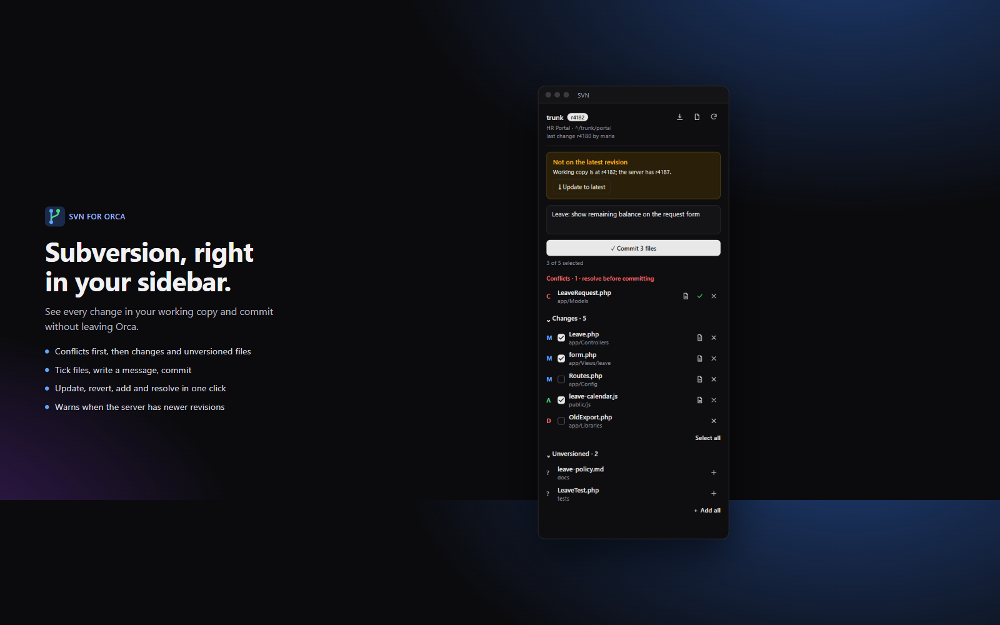
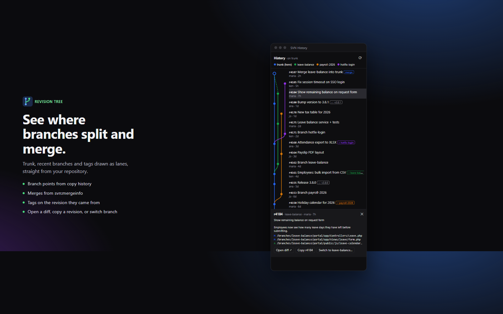

# SVN for Orca


An Orca plugin that adds a **SVN** sidebar panel for Subversion working copies:

- working-copy URL and revision;
- changed files grouped as Conflicted, Modified, Added, Deleted, Missing, Unversioned;
- tick files, write a message, **Commit** (unversioned files you tick are added first);
- **Update**, and per file **Diff** (opens in a terminal), **Add**, **Resolve**, **Revert** (with confirm);
- palette: SVN: Update, SVN: Commit…, SVN: Refresh, SVN: Show log;
- refreshes on workspace switch, after each action, and when files change (ignores `.svn/`).

Orca's built-in Source Control view stays git-only; SVN lives in this panel.

## Screenshots



*Changes, conflicts and commit in the sidebar*



*Revision tree with branches, merges and tags*


*Diffs open in a full editor tab*

## Requirements

- **Orca** 1.4.259 or newer (`engines.orca` in `orca-plugin.json`; developed and tested on Orca 1.4.263).
- **Subversion** command-line client 1.15.x or compatible (developed and tested on svn 1.15.0).
- The `svn` command-line client on PATH. With TortoiseSVN, re-run its installer and enable **command line client tools**.
- A saved login: run `svn update` once in a terminal and let it store your credentials. The plugin always runs `svn --non-interactive` and never asks for or stores passwords.

## Develop

```sh
orca plugin types .      # generate .orca/types
orca plugin test .       # unit + real temp-repo tests (svnadmin needed)
orca plugin check .
orca plugin dev watch .  # load into the running Orca app
```
