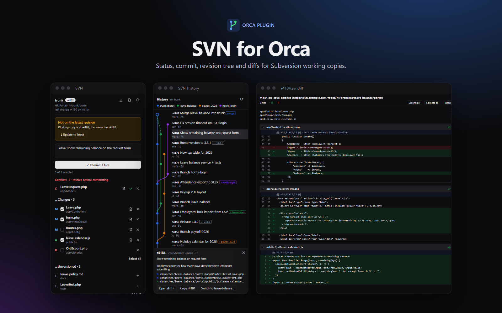

<div align="center">


<h1>SVN for Orca</h1>

<p>
<b>Subversion in Orca's sidebar.</b><br>
See a working copy's changes, then update, commit, revert, add, resolve and diff from one SVN panel. Orca's built-in Source Control view stays git-only; SVN lives in this panel.
</p>

<p>
<a href="LICENSE"></a>


</p>

<p>
<a href="#install">Install</a> ·
<a href="#changes-and-commit">Changes and commit</a> ·
<a href="#history">History</a> ·
<a href="#diffs">Diffs</a> ·
<a href="#requirements">Requirements</a> ·
<a href="#develop">Develop</a>
</p>



<p><sub>The SVN changes panel, the SVN History revision tree and the SVN Diff viewer.</sub></p>

</div>

## Install

[Open it in Orca](https://orca.dev/plugins/jameslatajan/orca-svn) or run:

```sh
orca plugin install jameslatajan.svn
```

> [!NOTE]
> Needs Orca 1.4.259 or newer and the Subversion command-line client (`svn`) on PATH. With TortoiseSVN, re-run its installer and enable **command line client tools**. See [Requirements](#requirements).

## Changes and commit


The **SVN** sidebar panel for Subversion working copies shows:

- working-copy URL and revision;
- changed files grouped as Conflicted, Modified, Added, Deleted, Missing, Unversioned;
- tick files, write a message, **Commit** (unversioned files you tick are added first);
- **Update**, and per file **Diff** (opens in a terminal), **Add**, **Resolve**, **Revert** (with confirm);
- palette: SVN: Update, SVN: Commit…, SVN: Refresh, SVN: Show log;
- refreshes on workspace switch, after each action, and when files change (ignores `.svn/`).

<sub>Changes, conflicts and commit in the sidebar</sub>

<br clear="right">

## History


Revision tree with branches, merges and tags.

<br clear="right">

## Diffs


Diffs open in a full editor tab.

<br clear="right">

## Requirements

- **Orca** 1.4.259 or newer (`engines.orca` in `orca-plugin.json`; developed and tested on Orca 1.4.263).
- **Subversion** command-line client 1.15.x or compatible (developed and tested on svn 1.15.0).
- The `svn` command-line client on PATH. With TortoiseSVN, re-run its installer and enable **command line client tools**.
- A saved login: run `svn update` once in a terminal and let it store your credentials. The plugin always runs `svn --non-interactive` and never asks for or stores passwords.

## Develop

<details>
<summary>Commands</summary>

```sh
orca plugin types .      # generate .orca/types
orca plugin test .       # unit + real temp-repo tests (svnadmin needed)
orca plugin check .
orca plugin dev watch .  # load into the running Orca app
```

</details>
